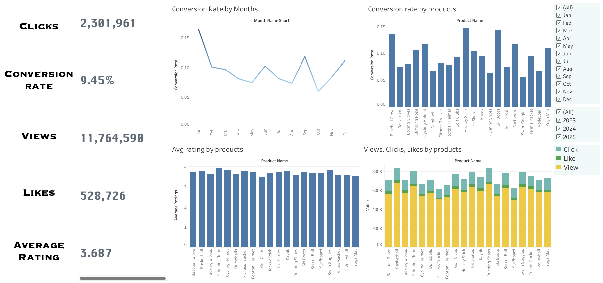
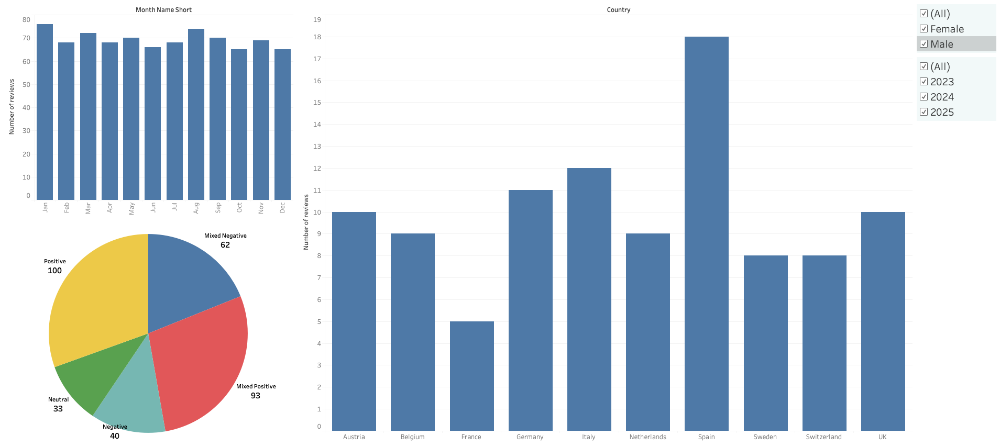

# Marketing Analytics — Product Engagement & Customer Reviews

## Project Overview

I built this project to explore product engagement and customer reviews using SQL and Tableau. The project covers two areas: how customers interact with different sports products and what customer reviews reveal about product sentiment.

I used PostgreSQL for working with the data and Tableau to build interactive dashboards with filters for exploring the results.

## Tools Used

- **PostgreSQL & SQL** — querying and working with the data
- **Docker** — running PostgreSQL locally
- **VS Code** — development environment
- **Tableau Public** — data visualisation and interactive dashboards

## Dashboard 1: Product Engagement

This dashboard explores conversion rates, product ratings, and customer engagement across sports products. It includes monthly conversion trends, conversion rates by product, average ratings, and a comparison of views, clicks, and likes.

### Key Findings

- The overall conversion rate shown on the dashboard is **9.45%**.
- Monthly conversion rates vary throughout the year, reaching approximately **16.5% in January** and falling to around **6% in October**.
- Hockey Stick and Ski Boots have the highest product conversion rates, at approximately **14.8% and 14.3%**, respectively.
- Average product ratings generally fall between **3.5 and 4.0**. Climbing Rope is among the highest-rated products, while Yoga Mat is among the lowest.
- Views account for the largest share of engagement across the products shown, followed by clicks and likes.

The dashboard includes filters for month and year to explore how the results change across different periods.

## Dashboard 2: Customer Reviews

This dashboard examines customer review volumes, sentiment distribution, and the countries represented in the dataset. It includes monthly review counts, a sentiment breakdown, and a country-level comparison.

### Key Findings

- Monthly review counts remain relatively consistent, ranging from approximately **65 to 78 reviews**.
- January has the highest monthly review count, at around **78**, followed by August at approximately **75**.
- Positive sentiment is the largest individual category, with **100 reviews**, followed by Mixed Positive with **93 reviews**.
- Spain has the highest review count among the countries shown, with **18 reviews**, followed by Italy with **12** and Germany with **11**.

The dashboard includes gender and review-year filters for exploring the review data from different perspectives.

## What I Learned

This project gave me practice connecting SQL-based data work with Tableau visualisation. It also helped me explore how to present engagement metrics and customer feedback together, while paying attention to metric definitions, aggregation, and data consistency.

## Tableau Public

Explore the interactive dashboards here:

[**View Marketing Analytics on Tableau Public**](https://public.tableau.com/app/profile/sahil5551/viz/MarketingAnalytics_17930918041280/Dashboard2)
